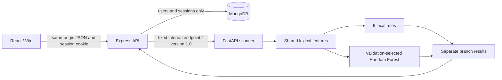

# Implemented architecture

Express owns accounts, scrypt hashing, MongoDB sessions, CSRF/origin checks, request bounds, rate limits, inference timeouts, response-schema validation, and static assets. FastAPI owns the one parsing/feature policy shared with offline training, deterministic rules, model loading, and the frozen decision policy. Browser application data travels through Express only.

The deployed decision is ML-only because the evaluated hybrid did not meet the predeclared minimum validation gain. Rule observations remain visible and are not attributed to model causality. Missing/invalid model files produce a `partial`, `rules_only` response. An inference exception or upstream failure produces an operational error without a safety verdict.

Compose publishes only the Express loopback port. Native demo processes also bind loopback, but loopback ports are accessible to other local applications: native mode is not container isolation. Training acquisition has network access; inference has no destination-network calls. The offline public-suffix snapshot is used for training groups only, never destination lookup.
